# Lab 1: Active Directory / IAM (Identity and Access Management) Home Lab

**Fictional company:** Sonder Energy Services (domain: `sonderenergy.internal`)

## Session 1: Hyper-V setup and Windows Server install

## Step 1: Readiness check
- **What I did:** Confirmed CPU virtualization is enabled; host is Windows 11 Pro.
- **Why it matters:** Hardware virtualization is required to run virtual machines.
- **Issues and how I fixed them:** Task Manager was blocked on my desktop by an administrator policy, so I moved the lab to my ThinkPad.

## Step 2: Hypervisor choice and downloads
- **What I did:** Chose Hyper-V over VirtualBox and enabled it. Downloaded Windows Server 2025 and Windows 11 Enterprise evaluation ISOs.
- **Why it matters:** Hyper-V is built into Windows 11 Pro, avoids conflicts with Windows security features, supports Windows 11's TPM requirement, and is used in enterprise environments.
- **Issues and how I fixed them:** First download was the Languages and Optional Features ISO, not the installer. Caught it by checking the file name and re-downloaded the SERVER_EVAL ISO.

## Step 3: Enabling Hyper-V (troubleshooting)
- **What I did:** Enabled Hyper-V, but the management console and Hyper-V service were missing even though Windows reported the feature as enabled. Verified with Get-WindowsOptionalFeature, Test-Path, and Get-Service, then disabled and re-enabled the feature with DISM to force a clean reinstall.
- **Why it matters:** Hyper-V is the hypervisor for the whole lab.
- **Issues and how I fixed them:** Feature state and actual install didn't match. Diagnosed it step by step instead of guessing, and DISM fixed it.

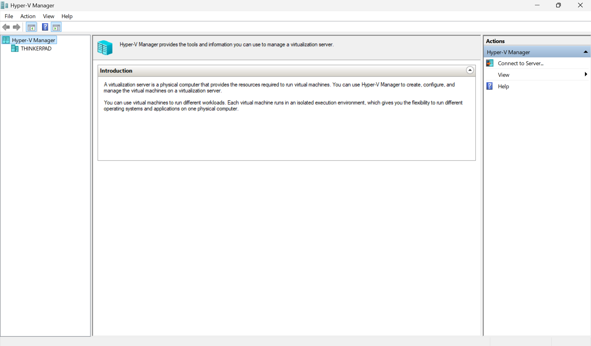

## Step 4: Created internal switch LabNet and NAT
- **What I did:** Created the internal switch LabNet and NAT on 10.10.10.0/24 with the host as gateway at 10.10.10.1, so lab VMs are isolated from my home network but still have internet.
- **Why it matters:** Mirrors how real companies keep domain controllers on an internal network, not exposed to the internet. NAT lets VMs get updates without outside access in.
- **Issues and how I fixed them:** None.

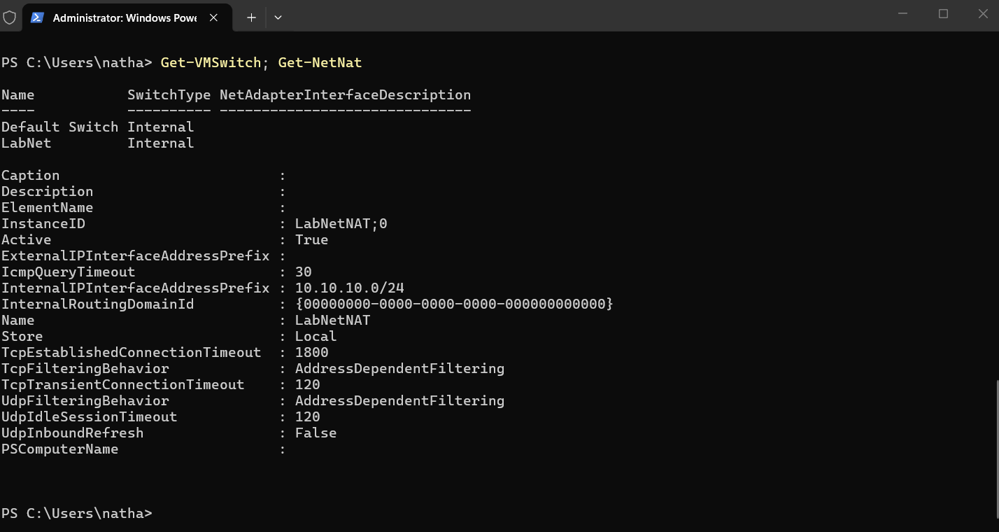

## Step 5: Created the DC01 Virtual Machine
- **What I did:** Created a Generation 2 VM named DC01 with 2 virtual processors, Dynamic Memory (2 GB startup, 4 GB max), a 60 GB dynamically expanding VHDX, and a connection to LabNet. Disabled automatic checkpoints.
- **Why it matters:** DC01 will be the domain controller, the server that stores all user accounts and handles every login. Generation 2 supports Secure Boot, which blocks untrusted software from loading at startup.
- **Issues and how I fixed them:** DC01 failed to start with "Unable to allocate 4096 MB of RAM." Task Manager showed only 1.7 GB free because 4.4 GB is reserved by integrated graphics and 9.9 GB was in use. Closed apps and lowered startup memory to 2 GB with a 4 GB dynamic maximum.

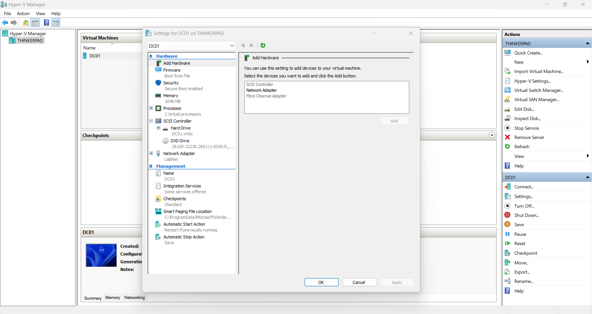

## Step 6: Installed Windows Server 2025
- **What I did:** Installed Windows Server 2025 Standard Evaluation (Desktop Experience) and set the built-in Administrator password.
- **Why it matters:** Standard fits a domain controller since Datacenter features aren't needed. Desktop Experience provides graphical tools for learning; Server Core is a future stretch goal since it reduces attack surface and memory use.
- **Issues and how I fixed them:** Missed the "Press any key to boot from CD or DVD" prompt, so the VM attempted a PXE network boot. Clicked into the VM window to give it keyboard focus, reset it, and pressed a key immediately.

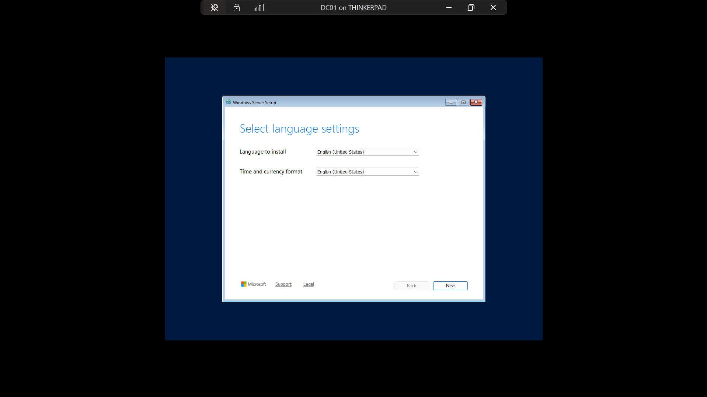

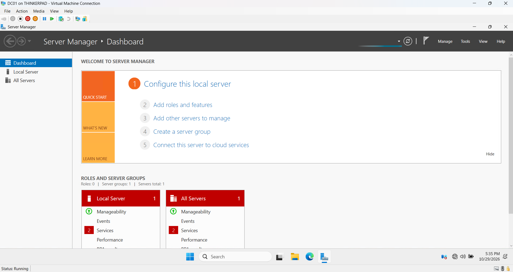

## Step 7: First checkpoint
- **What I did:** Shut down DC01 cleanly and created a checkpoint named "Fresh install".
- **Why it matters:** Provides a known-good restore point before configuring Active Directory, so mistakes can be rolled back in seconds instead of reinstalling.
- **Issues and how I fixed them:** First clicked on Save instead of Shut Down, which put the VM in a saved (hibernated) state. Learned the difference between Save, Shut Down, and Turn Off, then resumed the VM and shut it down properly before taking the checkpoint.

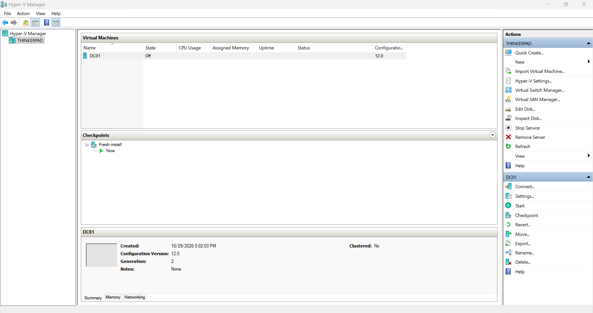

## Session 2: Creating Active Directory

## Step 8: Set up a static IP on DC01
- **What I did:** Assigned DC01 a static IP of 10.10.10.10/24 with gateway 10.10.10.1 and DNS pointing to itself. Verified with ipconfig.
- **Why it matters:** A domain controller needs a permanent address because every computer finds it by IP for logins and DNS. DNS points to itself because DC01 will become the DNS server for the domain.
- **Issues and how I fixed them:** Before the change, DC01 had a 169.254 APIPA address because LabNet has no DHCP server, which is why a static IP had to be set manually. After setting it, ping to the host gateway timed out because the host's Windows Firewall blocks inbound ICMP on the Public-profile LabNet adapter. Confirmed connectivity by pinging 1.1.1.1 successfully (0% loss).

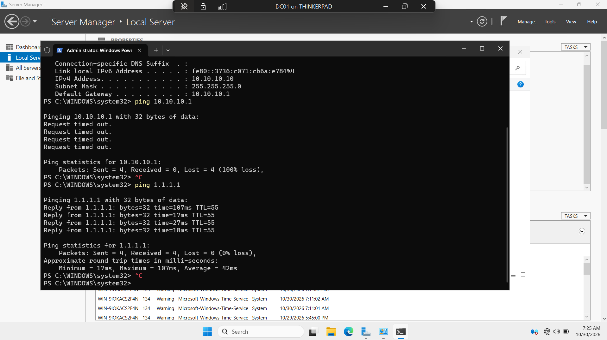

## Step 9: Renamed the server to DC01
- **What I did:** Renamed the server from its auto-generated name to DC01 and restarted. Verified with hostname.
- **Why it matters:** Follows a role-based naming convention so the server's purpose is clear. Done before promotion because a domain controller's name is recorded in Active Directory and DNS, making later renames complex.
- **Issues and how I fixed them:** After renaming, noticed DC01's clock was two hours behind because the time zone defaulted to Pacific during install. Fixed in Step 10.

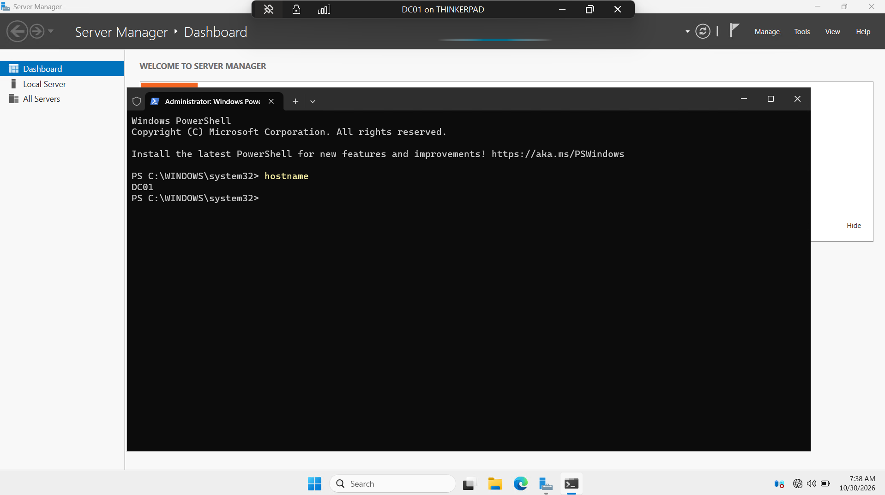

## Step 10: Installed the AD DS role
- **What I did:** Set the time zone to Central, then installed the Active Directory Domain Services role and its management tools (Group Policy Management, Active Directory Administrative Center, AD DS snap-ins, and the Active Directory PowerShell module) through Server Manager.
- **Why it matters:** AD DS is the software that makes a server a domain controller. Installing the role adds the software only; promotion configures it.
- **Issues and how I fixed them:** Set the time zone to Central with Set-TimeZone before promotion, so event logs and timestamps match local time and the clock is correct ahead of Kerberos authentication.

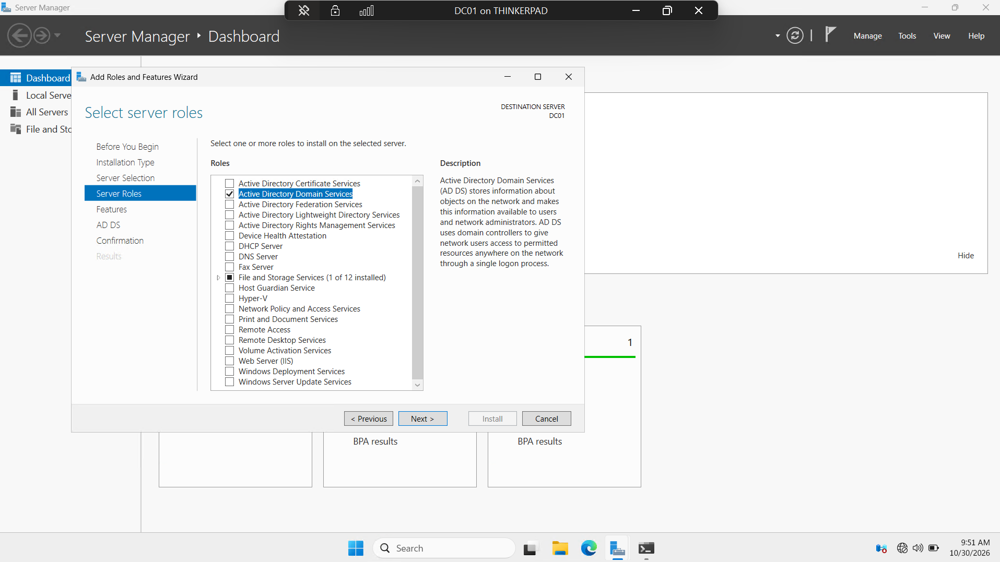

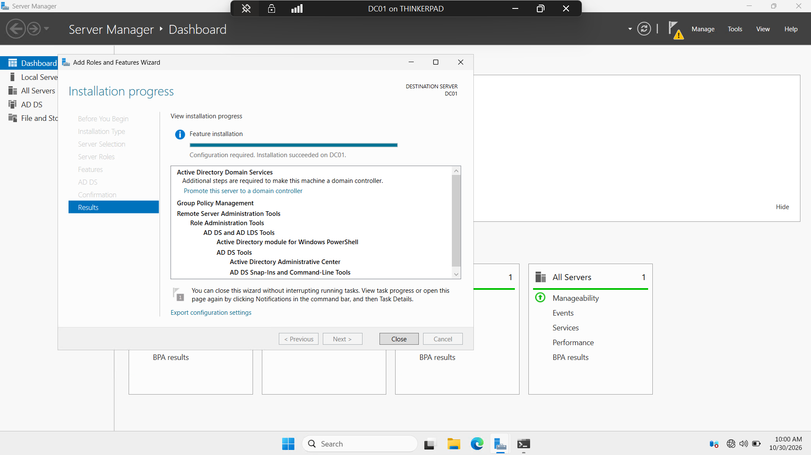

## Step 11: Pre-promotion checkpoint
- **What I did:** Shut down DC01 and created a checkpoint named "AD DS installed, pre-promotion".
- **Why it matters:** Promotion is the largest and hardest-to-reverse change in the build. Taking a restore point before a major change mirrors standard change management practice.
- **Issues and how I fixed them:** After restarting, Server Manager briefly showed Roles: 0. Confirmed in Hyper-V Manager that the checkpoint tree was correct (no rollback), then refreshed Server Manager after it finished loading and confirmed Roles: 2 with AD DS listed.

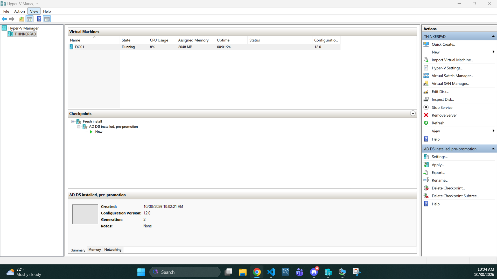

## Step 12: Promoted DC01 to a domain controller
- **What I did:** Ran the AD DS Configuration Wizard to create a new forest with root domain sonderenergy.internal (NetBIOS: SONDERENERGY). Set forest and domain functional levels to Windows Server 2025, installed DNS, kept Global Catalog enabled, set a separate DSRM password, and kept default paths for NTDS and SYSVOL. Saved the generated PowerShell script as promote-dc01.ps1.
- **Why it matters:** Promotion creates the domain and turns DC01 into the authority for every login and DNS lookup. The DSRM password is a separate recovery account that works when Active Directory is offline. ntds.dit holds every password hash in the domain, making domain controllers high-value targets.
- **Issues and how I fixed them:** DNS delegation warning appeared because .internal has no public parent zone. Not needed since lab clients query DC01 directly.

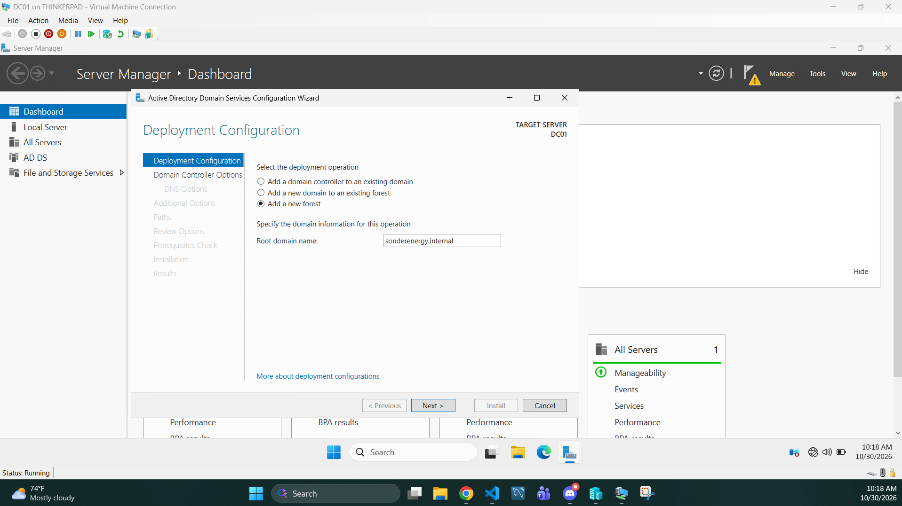

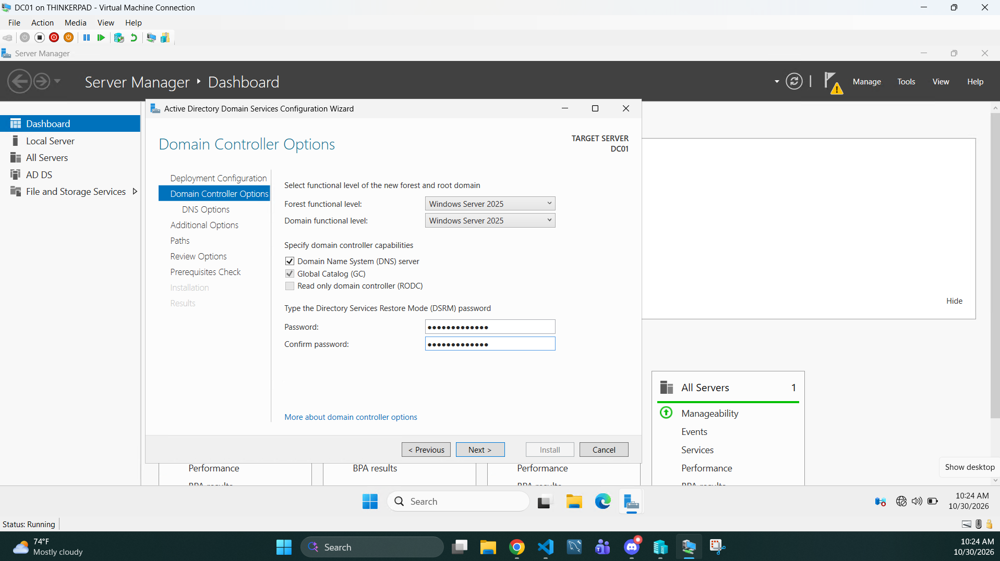

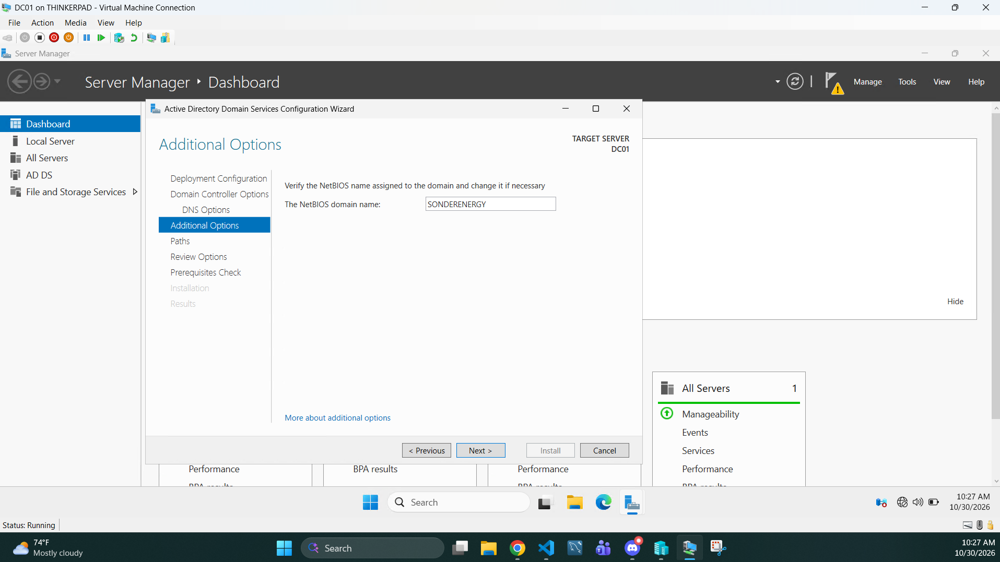

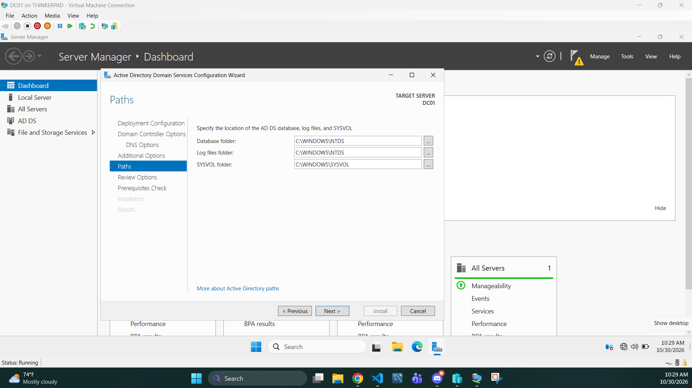

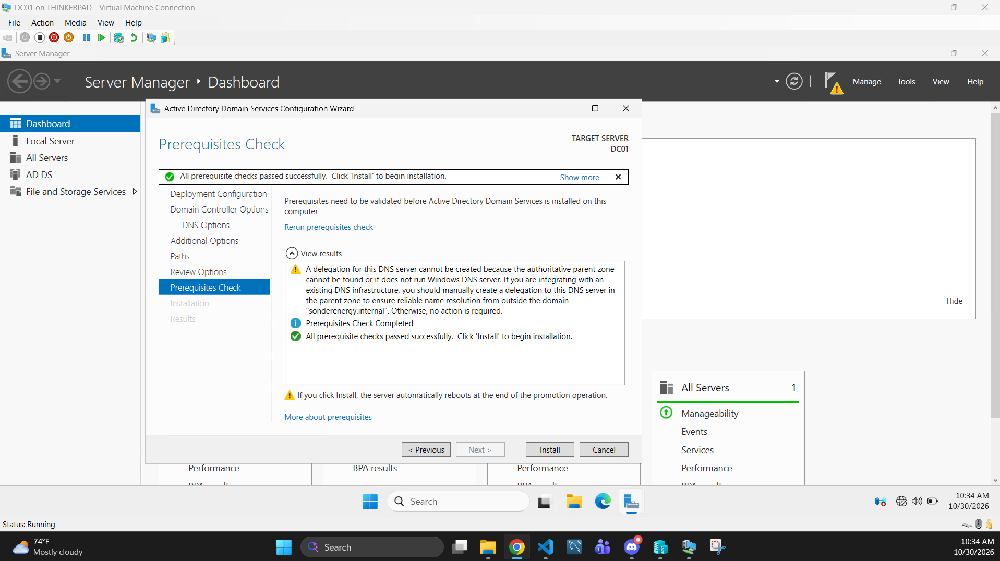

## Step 13: Verified the domain
- **What I did:** Signed in as SONDERENERGY\Administrator. Verified the domain with Get-ADDomain, confirmed the Server Manager shows the AD DS and DNS roles, and tested the DNS with nslookup for both the internal domain and an external site.
- **Why it matters:** Active Directory depends on DNS, so both had to be confirmed working. sonderenergy.internal resolving to 10.10.10.10 proves clients will be able to find the domain controller.
- **Issues and how I fixed them:** Server Manager showed Roles: 0 for several minutes after the first post-promotion boot while services started. First Get-ADDomain attempt failed from a typo (missing hyphen); recognized the "not recognized" error and corrected the typo.

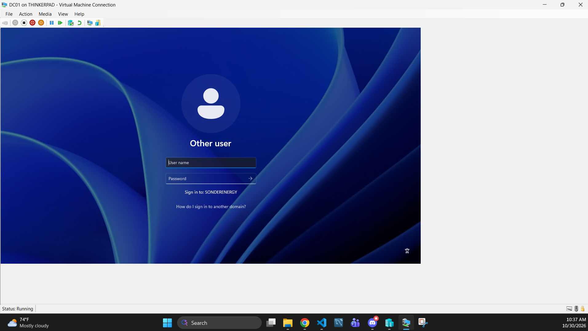

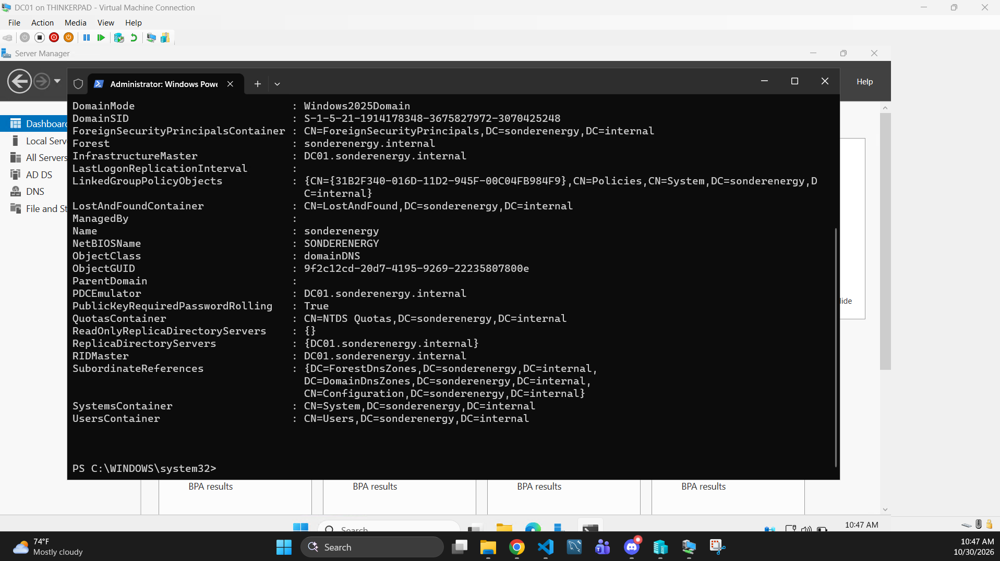

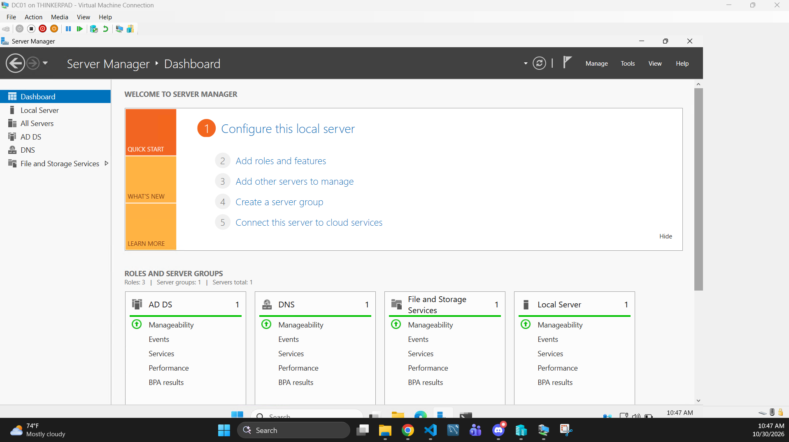

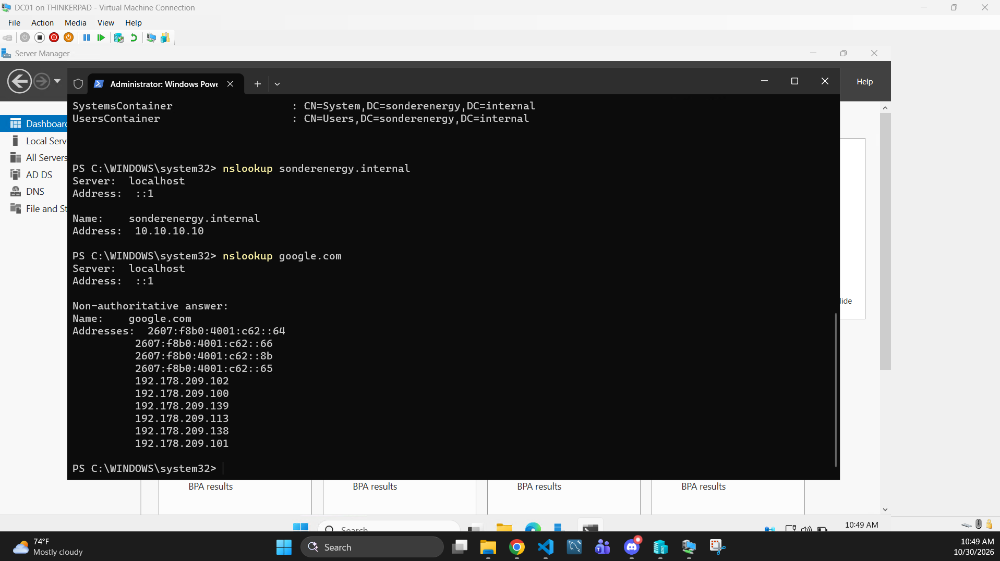

## Step 14: Domain created checkpoint
- **What I did:** Shut down DC01 and created a checkpoint named "Domain created".
- **Why it matters:** Saves a clean, working domain controller before adding users, groups, and policies.
- **Issues and how I fixed them:** None.

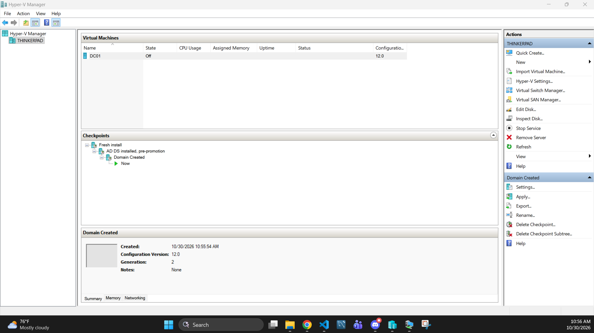

## Session 3: Organizing the company (OUs, Users, Groups)

## Step 15: Explored Active Directory Users and Computers
- **What I did:** Opened Active Directory Users and Computers (ADUC) and reviewed the default structure created by promotion: Builtin, Computers, Domain Controllers, ForeignSecurityPrincipals, Managed Service Accounts, and Users.
- **Why it matters:** Most default folders are containers, not OUs. Group Policy can't be linked to containers and delegation is limited, so a custom OU structure is needed. Domain Admins in the Users container is one of the most sensitive groups in the domain.
- **Issues and how I fixed them:** None.

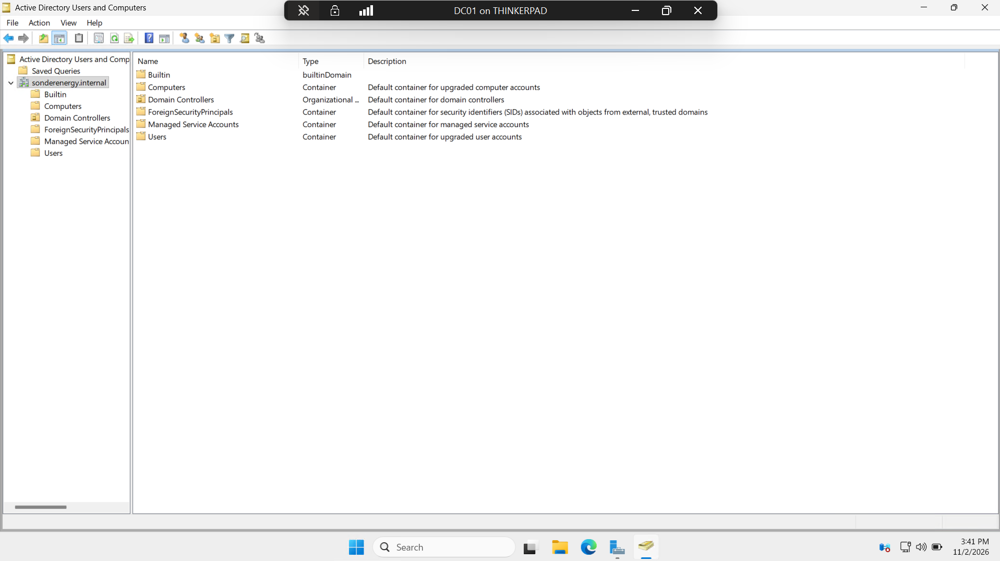

## Step 16: Designed the OU structure and created the top-level OU
- **What I did:** Designed the planned OU structure for Sonder Energy Services and created the top-level SonderEnergy OU manually in ADUC, with protection from accidental deletion enabled. The sub-OUs are created in Step 17.
- **Why it matters:** OUs, unlike default containers, support Group Policy and delegation. The structure is built around how objects will be managed: department-level policies, separate workstation and server policies, isolated service accounts for monitoring, and a DisabledUsers OU for offboarding.
- **Issues and how I fixed them:** None.

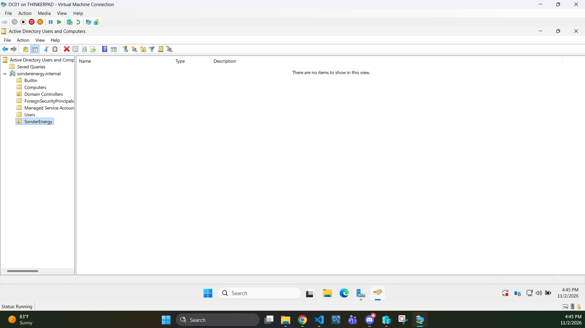

## Step 17: Scripted the OU structure with PowerShell ISE
- **What I did:** Automated OU creation by scripting create-ous.ps1 in PowerShell ISE in five commented sections, running each one separately with F8. Stored the base distinguished name in a $base variable, used New-ADOrganizationalUnit to create Users, Groups, Computers, ServiceAccounts, and DisabledUsers inside SonderEnergy, then used foreach loops to create department OUs (Engineering, Finance, HR, IT, Operations) under Users, and Workstations and Servers under Computers. Verified all 13 OUs with Get-ADOrganizationalUnit and in ADUC.
- **Why it matters:** Scripting repetitive work is faster, consistent, and repeatable. Running sections one at a time isolates errors, and comments make the script readable for others. Separate Workstations and Servers OUs allow different Group Policy for each.
- **Issues and how I fixed them:**
    - DC01 failed to start (0x8007000E, not enough memory) even with the same apps open as the previous session, since app memory use grows over time. Restarted the host and started DC01 before opening other apps.
    - Variables are cleared when PowerShell closes, so reran the $base line before continuing after a break.
    - A previous sitting ended with Section 2 only partly written and never run. Checked ADUC to confirm no OUs existed before running it, avoiding duplicates.
    - Renamed planned OUs to remove spaces (ServiceAccounts, DisabledUsers) for consistency and easier scripting.

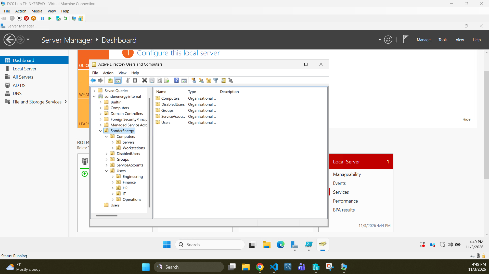

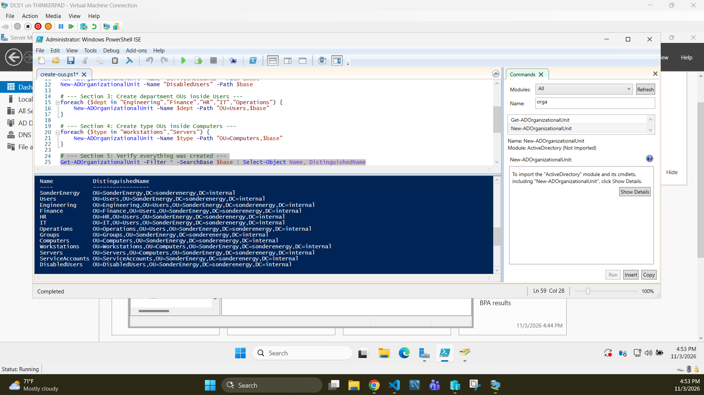

## Step 18: Created first employee account
- **What I did:** Created Maria Lopez (IT Support Specialist) by hand in the IT OU using ADUC, following a firstname.lastname naming convention (UPN: maria.lopez@sonderenergy.internal). Set a temporary password with "User must change password at next logon" and left "Password never expires" unchecked. Filled in Description, Office, E-mail, Job Title, Department, and Company attributes.
- **Why it matters:** A consistent naming convention keeps usernames predictable and readable in logs. Forcing a password change at first logon means only employees know their real password. Attributes like Department and Job Title drive real IAM processes such as dynamic groups, HR-driven provisioning, and audits. New accounts start with only Domain Users membership, following least privilege.
- **Issues and how I fixed them:** None.

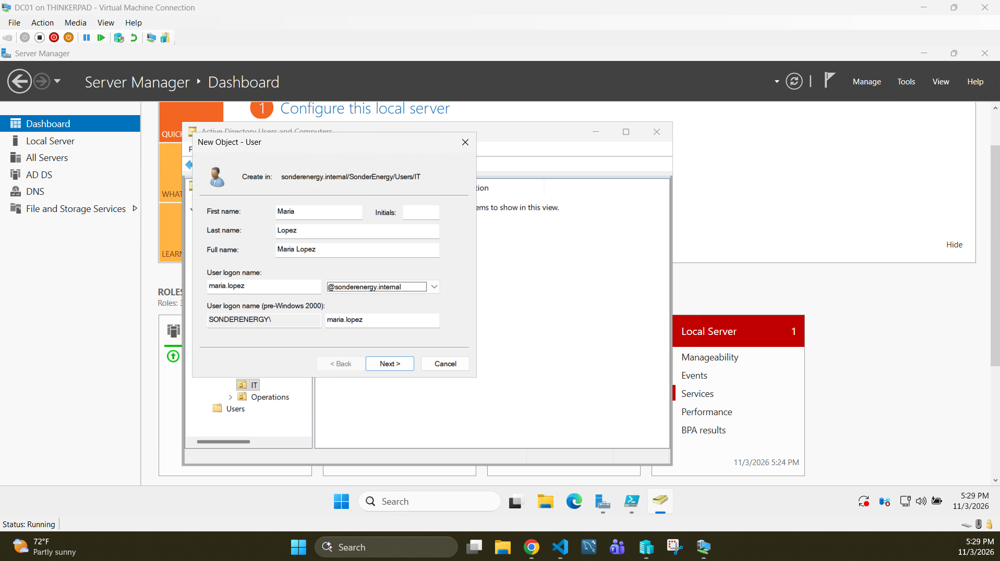

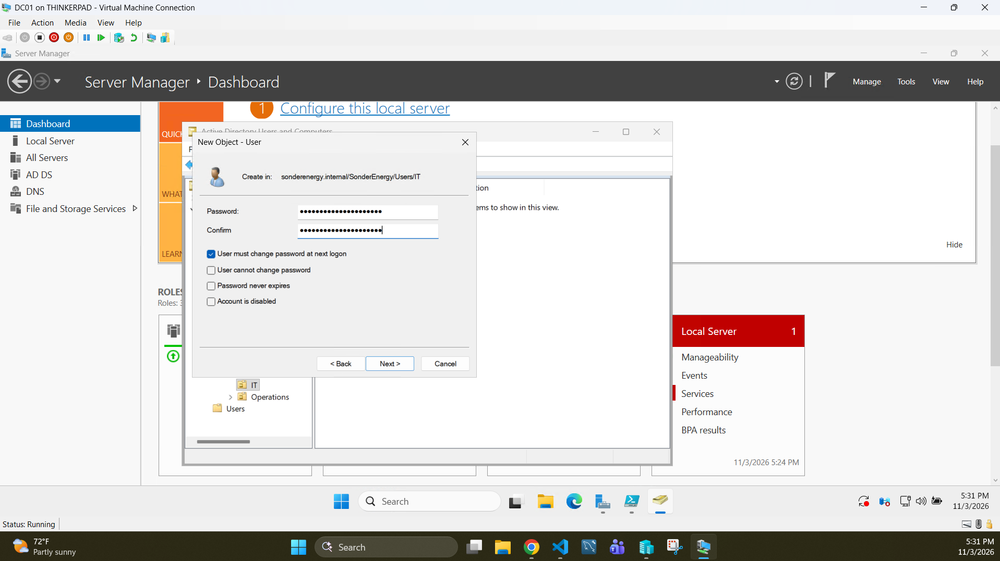

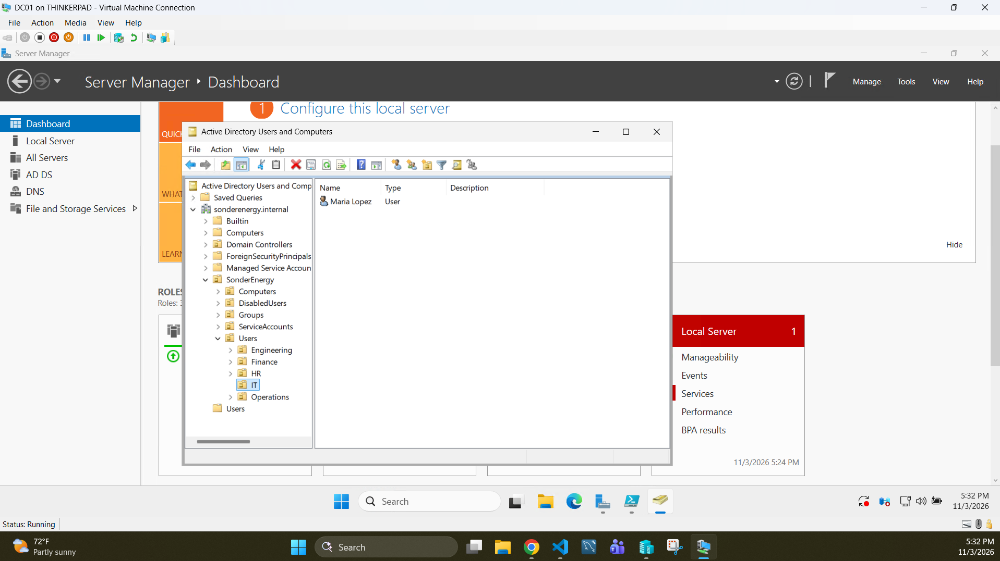

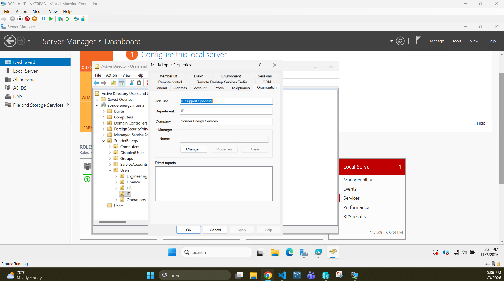

## Step 19: Automated account provisioning with PowerShell
- **What I did:** Automated account provisioning by scripting create-users.ps1 in PowerShell ISE in four sections. Section 1 stored the domain and Users OU in variables and prompted for a temporary password with Read-Host -AsSecureString. Section 2 created Daniel Kim (IT Manager) with New-ADUser and set him as Maria Lopez's manager with Set-ADUser. Section 3 created eight more employees across HR, Finance, Engineering, and Operations by looping through a data table of hashtables with one New-ADUser command. Section 4 linked each staff member to their department lead using a hashtable as a lookup table. Verified all 10 employees, their departments, titles, and managers with Get-ADUser, and confirmed direct reports in ADUC.
- **Why it matters:** Separating data (who to create) from logic (how to create them) makes onboarding repeatable: new hires only require new data, and shared settings are written once so they can't drift between accounts. No password is stored in the script. New-ADUser creates disabled accounts by default, so accounts are explicitly enabled. Manager attributes build the org structure, and Active Directory automatically maintains the matching direct reports.
- **Issues and how I fixed them:**
    - Mistyped a variable ($userOU) during a check. PowerShell returned nothing instead of an error, showing that misspelled variables fail silently.
    - Set-ADUser failed from a typo in the manager's username. Read the error, fixed it, and reran. The rerun showed New-ADUser "already exists" because the first run had partly succeeded. Learned to rerun only the failed line.
    - Found a typo in a Description value ("IT Manger") that PowerShell couldn't catch since text values are saved as typed. Corrected it with Set-ADUser and fixed the script.
    - Caught a parameter name typo (-UserPrincipleName) by reviewing the script before running. It would have failed all eight account creations.

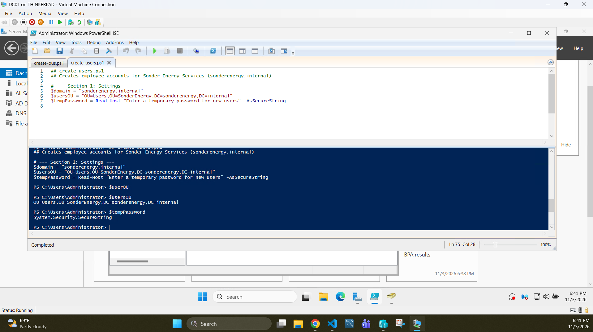

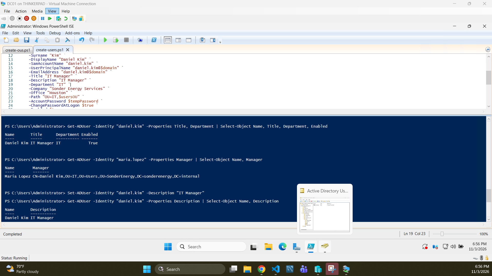

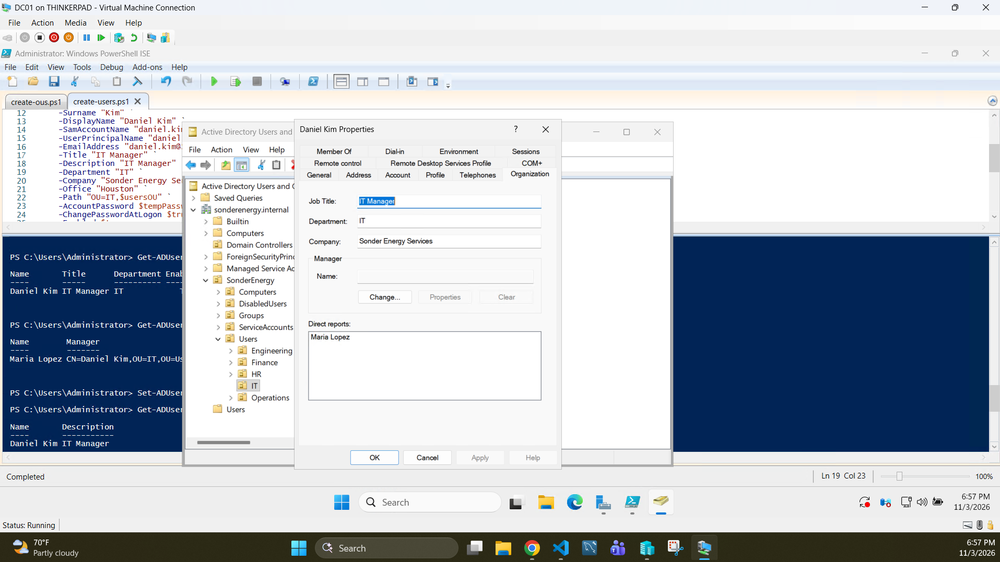

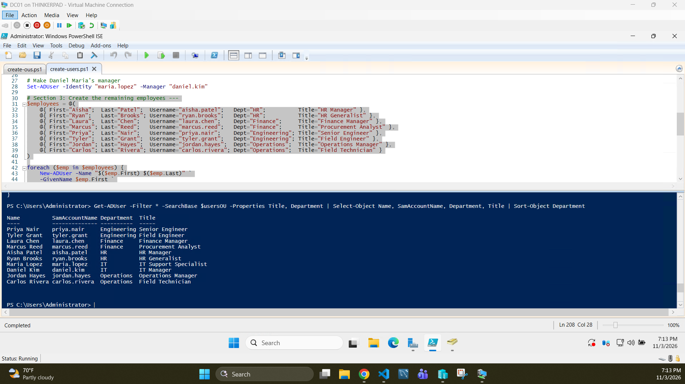

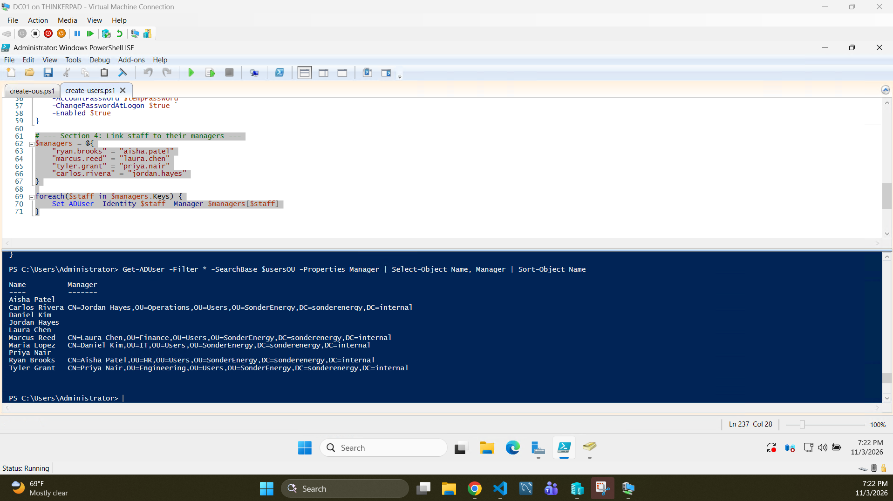

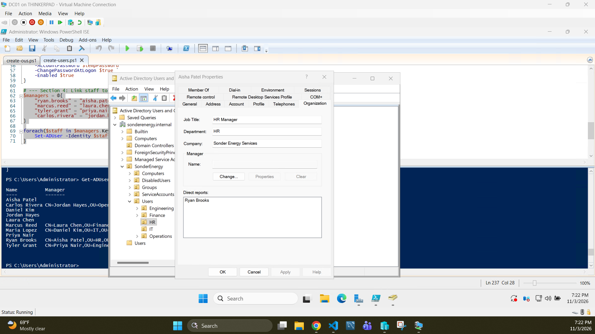

## Step 20: Built role-based security groups
- **What I did:** Implemented role-based access control (RBAC) groups using a SG- naming convention. Created SG-IT by hand in ADUC (Global scope, Security type) and added members with Check Names. Scripted the rest in create-groups.ps1: department groups (SG-Engineering, SG-Finance, SG-HR, SG-Operations) were created with New-ADGroup and populated automatically by filtering users on their Department attribute. Created role groups SG-Managers, populated by finding users with direct reports, and SG-IT-HelpDesk, assigned by name. Verified all 7 groups and their members with Get-ADGroup and Get-ADGroupMember.
- **Why it matters:** Granting access to groups instead of individuals makes onboarding, offboarding, and access reviews manageable. Attribute-driven membership keeps groups accurate as people join or change roles. Privileged groups like the help desk are assigned deliberately, since powerful permissions should require approval rather than happen automatically.
- **Issues and how I fixed them:**
    - A typo in the Users OU distinguished name (DCinternal instead of DC=internal) was stored without error. Caught it by checking the variable's value before using it, preventing a confusing search failure in the next section.

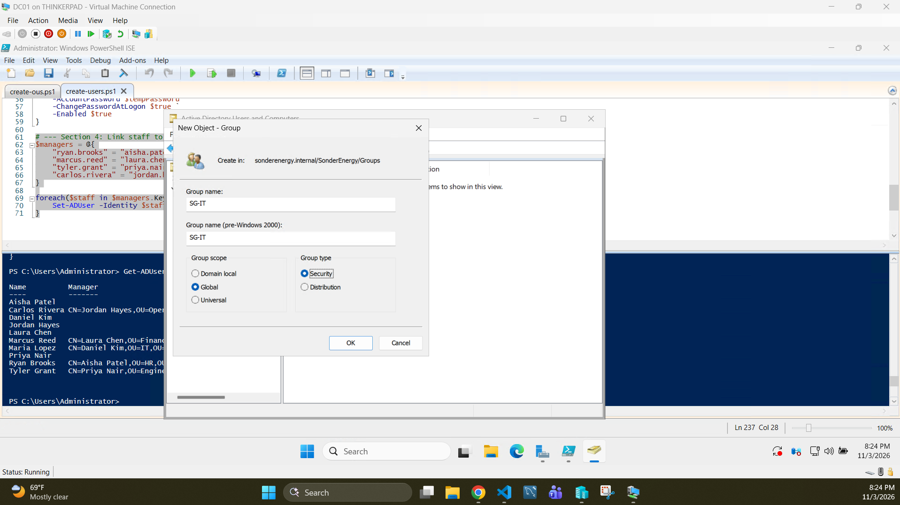

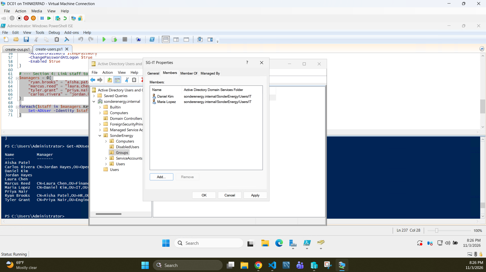

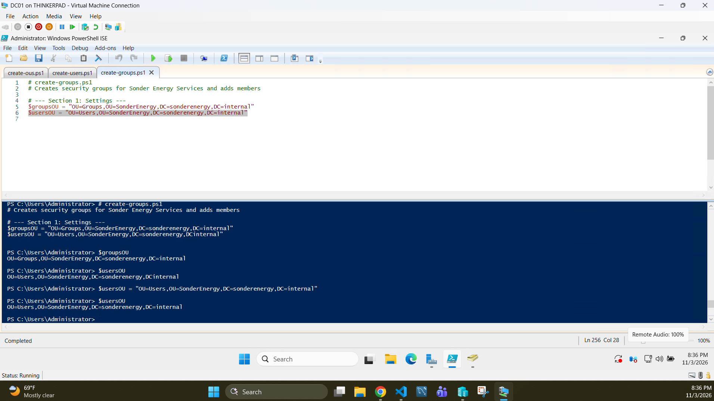

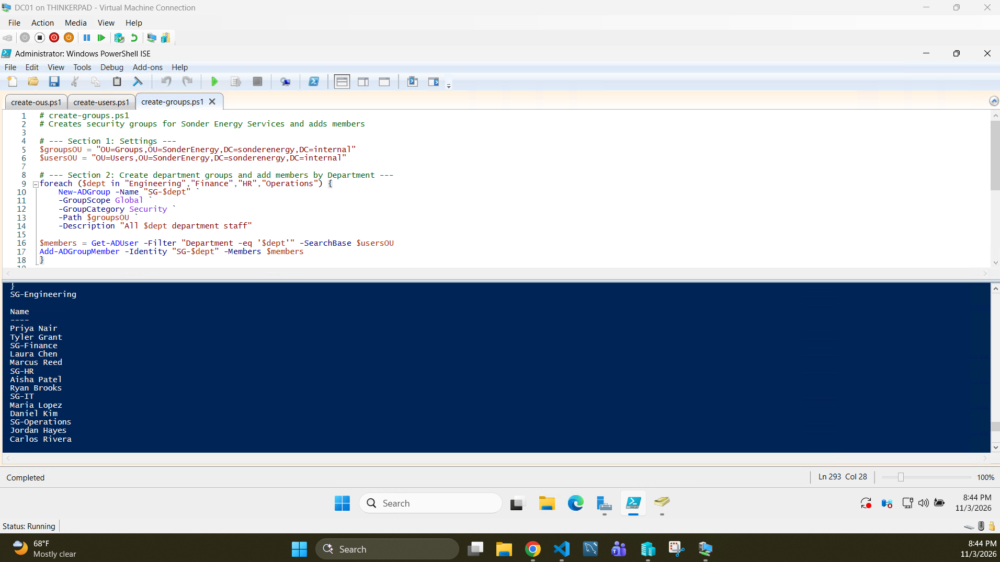

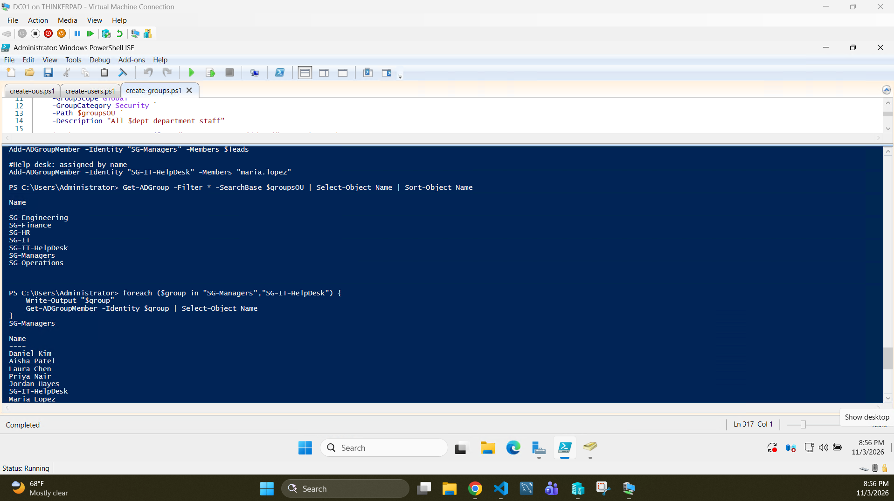

## Step 21: Session 3 verification and checkpoint
- **What I did:** Confirmed Maria Lopez belonds to Domain Users, SG-IT, and SG-IT-HelpDesk, showing layered access by organization, department, and role. Copied all scripts to the project folder, shut down DC01, and created a "Session 3 complete" checkpoint.
- **Why it matters:** Users typically belong to several groups, each granting a different slice of access. The checkpoint preserves a fully organized domain before Group Policy changes.
- **Issues and how I fixed them:** None.

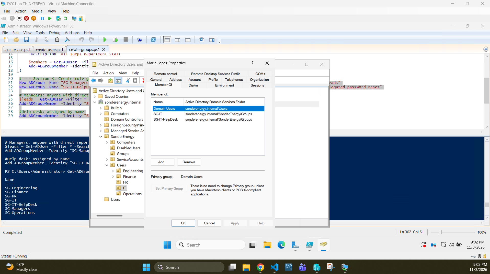

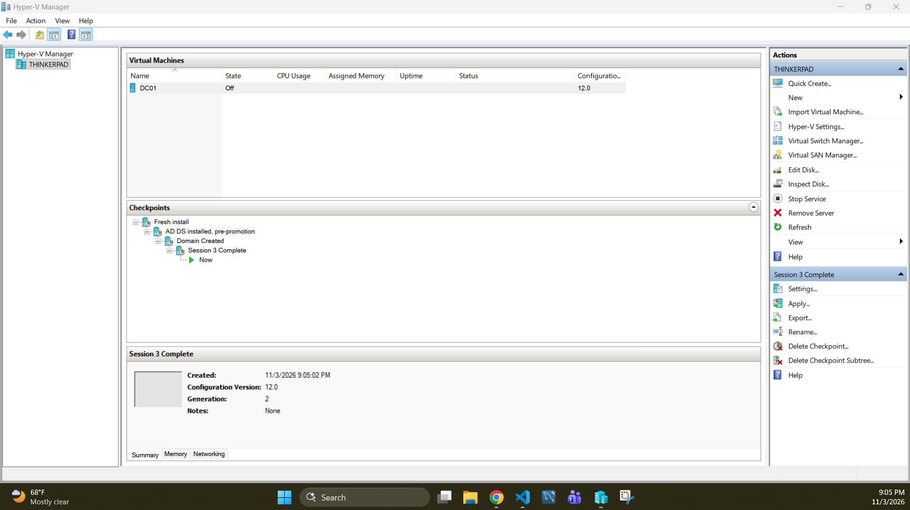

## Session 4: Domain-joined Windows 11 Workstation

## Step 23: Created and installed WS01 workstation
- **What I did:** Created a generation 2 VM named WS01 with 2 virtual processors, a 64 GB dynamically expanding disk, TPM and Secure Boot enabled, and a connection to LabNet. Installed Windows 11 Enterprise Evaluation with a separate local admin account, then lowered memory to 2 GB startup (1 GB minimum, 3 GB maximum) after installation.
- **Why it matters:** WS01 represents an employee's computer. Windows 11 requires TPM 2.0, Secure Boot, 2 processors, 4 GB RAM to install, and a 64 GB disk, reflecting modern endpoint security baselines. Enterprise edition supports domain join; Windows 11 Home does not.
- **Issues and how I fixed them:** 
- Only 2.4 GB was available with DC01 running, below the installer's 4 GB requirement. Hyper-V VM memory doesn't appear in Task Manager's process list. Installed WS01 with DC01 shut down, capped DC01's maximum memory at 3 GB, then reduced WS01 to 2 GB startup after installation.
- Clicked Finish before capturing the wizard summary; use the VM Settings page instead.

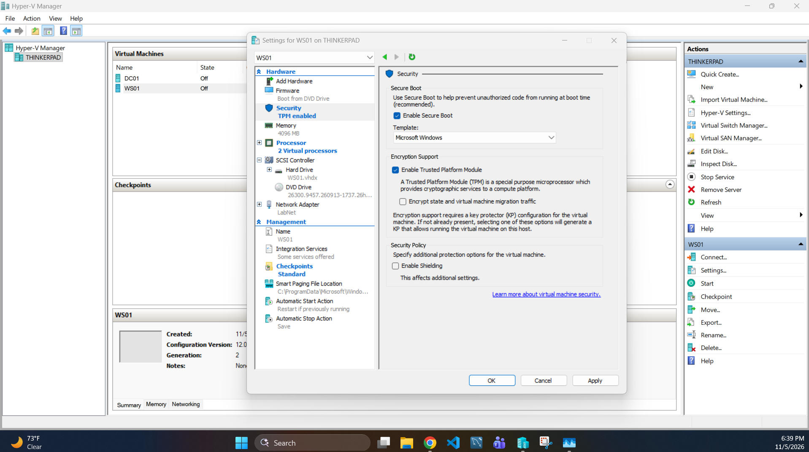

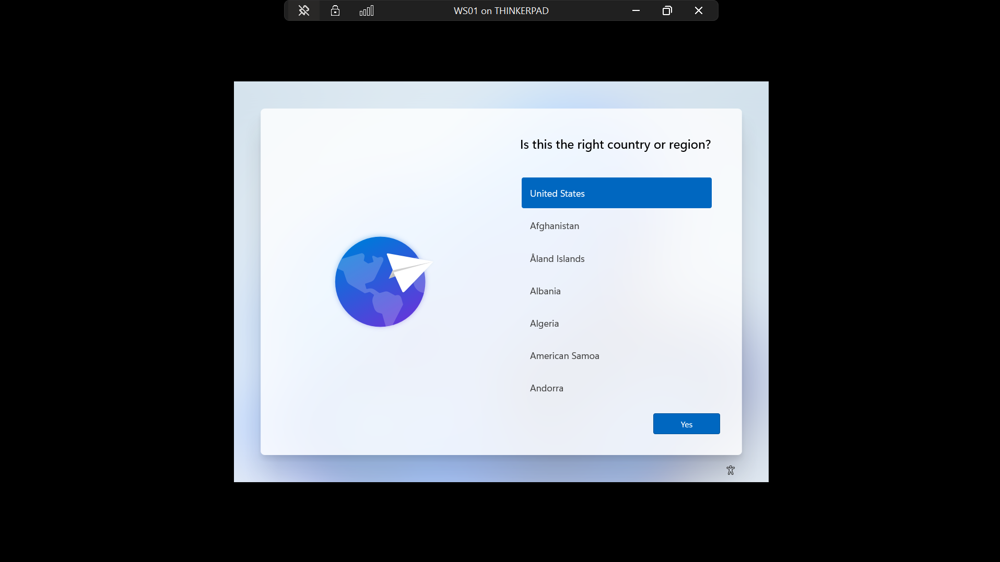

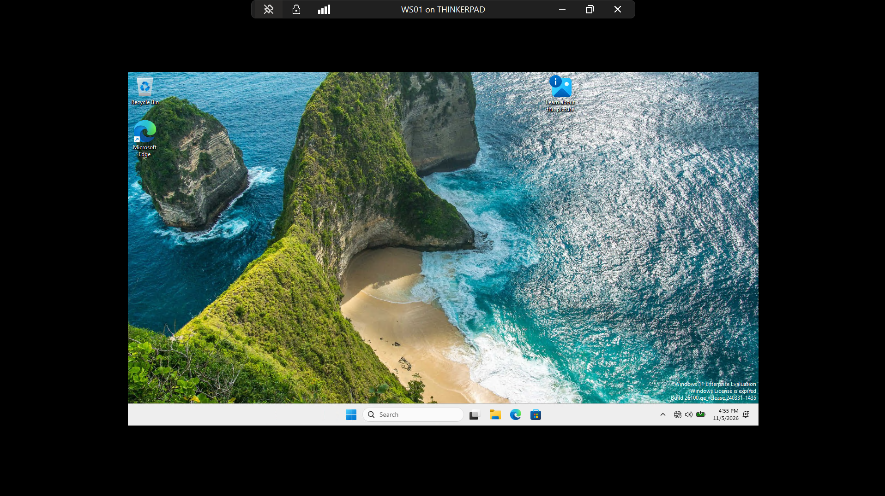

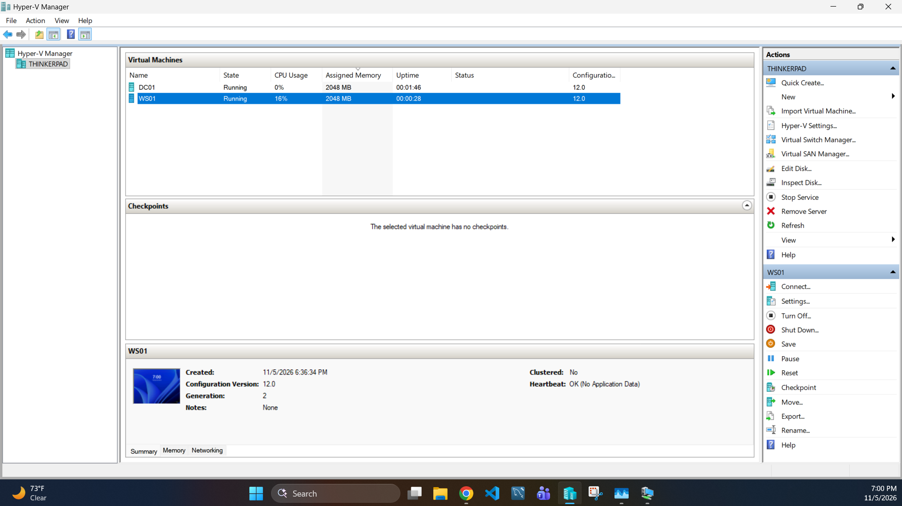

## Step 24: Configured WS01 networking with PowerShell
- **What I did:** Assigned WS01 a static IP of 10.10.10.20/24 with a gateway 10.10.10.1 and DNS pointing to DC01 (10.10.10.10) using New-NetIPAddress and Set-DnsClientServerAddress. Verified with ipconfig /all and nslookup.
- **Why it matters:** Domain join depends on DNS. Clients find the domain controller by querying DNS, so a workstation must use the DC as its DNS server. Misconfigured DNS is one of the most common causes of failed domain joins.
- **Issues and how I fixed them:** nslookup showed "DNS request timed out" and "Server: UnKnown" before returning the correct answer. This is a failed reverse lookup, because DC01 has no reverse lookup zone; forward lookups worked.

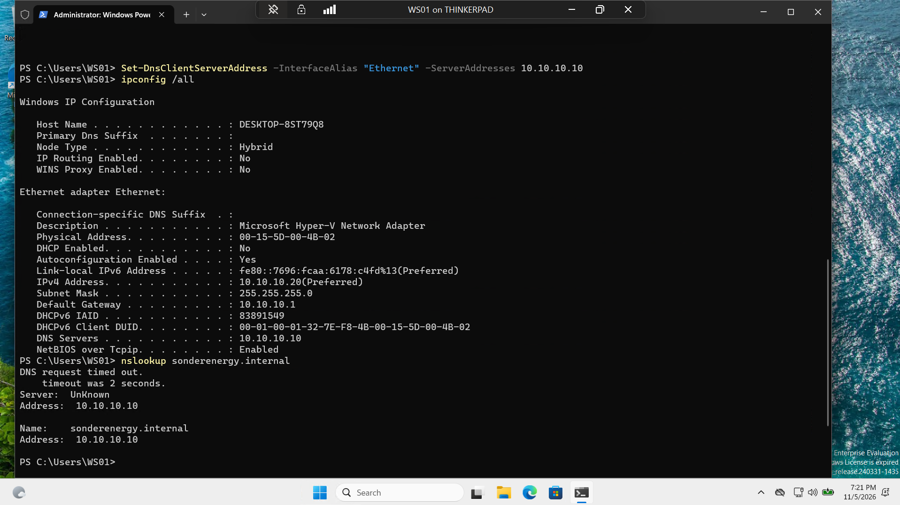

## Step 25: Activated Windows
- **What I did:** Investigated a "Windows License is expired" watermark. Confirmed internet access, checked license details with slmgr /dlv and activated online with slmgr /ato.
- **Why it matters:** An unactivated evaluation can restrict use. Diagnosing the cuase avoided an unnecessary reinstall.
- **Issues and how I fixed them:** The warning appeared becauase WS01 had no network during setup and couldn't activate. Activation succeeded once networking was configured, and the license now shows valid for 90 days.

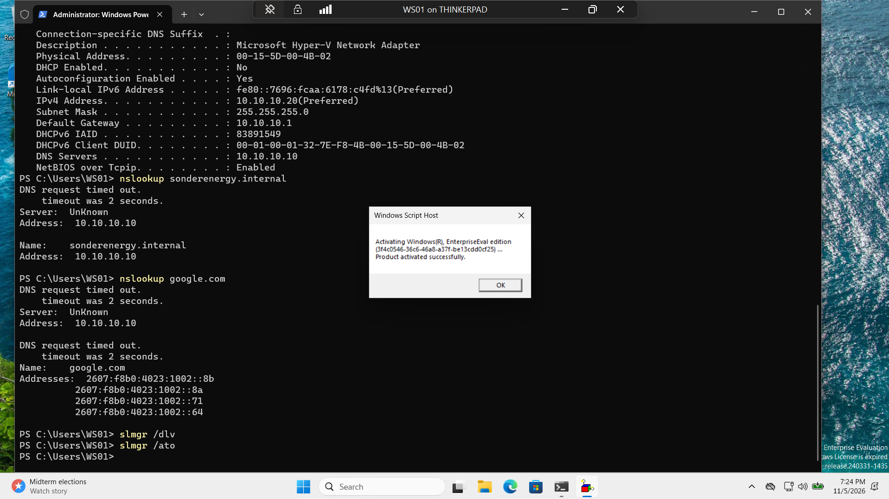

## Step 26: Joined WS01 to the domain
- **What I did:** Renamed the computer and joined it to sonderenergy.internal in one command with Add-Computer, using domain admin credentials. Signed in as maria.lopez, completed the forced password change, and verified the domain login and group memberships (SG-IT, SG-IT-HelpDesk) with whoami and whoami /groups.
- **Why it matters:** Domain join creates a computer account in Active Directory, lets employees sign in with domain credentials checked by the DC, and enables Group Policy. Group memberships travel with the user's login and drive access to resources.
- **Issues and how I fixed them:** Maria's sign-in was blocked with a Remote Desktop rights error because Hyper-V Enhanced Session connects over RDP, and standard users aren't in the Remote Desktop Users group by default. Switched to a basic session instead of granting unneeded remote access, following least privilege.

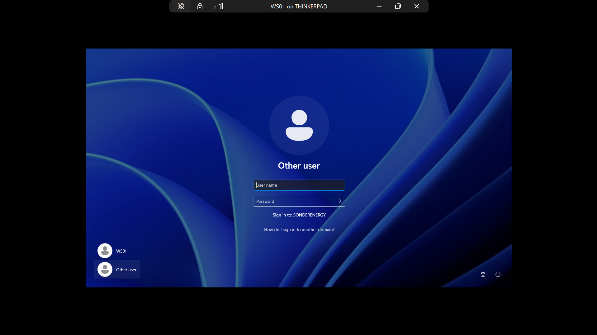

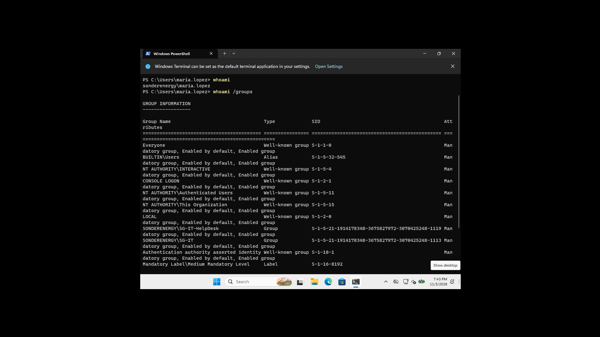

## Step 27: Moved WS01 into the Workstations OU
- **What I did:** Moved the WS01 computer account from the default Computers container account from the default Computers container to SonderEnergy/Computers/Workstations in ADUC.
- **Why it matters:** New computers land in the default Computers container, which can't receive Group Policy. Placing WS01 in the Workstations OU lets workstation policies apply to it.
- **Issues and how I fixed them:** None.

## Step 28: Session 4 checkpoints
- **What I did:** Shut down WS01 first, then DC01,
  and created "Session 4 complete" checkpoints on
  both VMs.
- **Why it matters:** Shutting down workstations
  before the domain controller they depend on
  mirrors planned maintenance order. Checkpoints
  save a working domain-joined environment before
  Group Policy changes in Session 5.
- **Issues and how I fixed them:** None.

## Session 5: Group Policy

## Step 29: Reviewed the Default Domain Policy
- **What I did:** Opened the Group Policy Management Console (GPMC) and reviewed the Default Domain Policy's password and lockout settings.
- **Why it matters:** The default lockout threshold was 0, meaning accounts never lock and password guessing is unlimited. Minimum length was only 7.
- **Issues and how I fixed them:**
    - WS01 failed to start from low host memory. Disabled unneeded startup apps, restarted the host, and started DC01 before WS01.
    - The GPMC Settings report was blocked by IE Enhanced Security Configuration. Allowed only the local about:security_mmc.exe page, keeping we browsing blocked on the DC.

## Step 30: Hardened password and lockout policy
- **What I did:** Edited the Default Domain Policy: minimum password length 14, maximum password age 365 days, account lockout threshold 10, lockout duration 15 minutes, and counter reset after 15 minutes.
- **Why it matters:** Length is the strongest defense against password cracking. Lockout stops brute force guessing. Following NIST SP 800-63B, avoided frequent forced changes that lead to predictable password. Domain password policy only applies from a GPO linked at the domain level.
- **Issues and how I fixed them:** None.

[!Password policy](Screenshots/55-password-policy.png)

## Step 31: Created a workstation security GPO
- **What I did:** Created and linked SE-Workstation-Security to the Workstations OU, using a naming convention (company prefix, target, purpose). Configured a 15-minute inactivity lock, hid the last signed-in user, and added a legal logon banner.
- **Why it matters:** Linking at the OU level targets only workstations, not servers. These settings recude risk from unattended computers, avoid exposing valid usernames, and meet common compliance expectations for logon banners.
- **Issues and how I fixed them:** None.

## Step 32: Applied and verified Group Policy
- **What I did:** Restarted WS01, confirmed the logon banner and hidden username, then verified applied GPOs with gpresult /scope computer /r. Both SE-Workstation-Security and Default Domain Policy applied.
- **Why it matters:** gpresult is the first tool for troubleshooting policies that don't seem to apply. It shows which GPOs applied and why.
- **Issues and how I fixed them:**
    - Policies didn't appear after the first
      restart because of Fast Logon Optimization,
      which applies policy in the background.
      A second restart applied them.
    - Elevated on WS01 with the Domain Admin
      account, which leaves privileged credentials
      on a workstation where they could be stolen.
      Restarted WS01 to clear them and used the
      local admin account afterward, following
      tiered administration.

## Step 33: Tested account lockout and unlock
- **What I did:** Entered 10 wrong passwords for maria.lopez on WS01 to trigger lockout, found the locked account with Search-ADAccount-LockedOut, unlocked it with Unlock-ADAccount, and confirmed she could sign in again.
- **Why it matters:** Proves the lockout policy stops brute force attempts domain-wide. Finding and unlocking accounts is a common help desk task, and should follow identity verification to prevent social engineering.
- **Issues and how I fixed them:** None.

## Step 34: Session 5 checkpoints
- **What I did:** Shut down WS01, then DC01, and created "Session 5 complete" checkpoints on both VMs.
- **Why it matters:** Saves a working environment with hardened domain policies before the joiner, mover, leaver work in Session 6.
- **Issues and how I fixed them:** None.

## Session 6: Joiner, mover, leaver lifecycle

## Step 35: Onboarded a new hire (joiner)
- **What I did:** Scripted onboarding in joiner.ps1: created Sofia Martinez (Finance, Accounts Payable Specialist) with New-ADUser, set her manager at creation, kept the account disabled until her start date, added her to SG-Finance, then enabled the account with Enable-ADAccount. Verified with Get-ADUser.
- **Why it matters:** Pre-staging accounts as disabled avoids active, unmonitored accounts before start dates. Access comes from the role-based group, not copied from a coworker, which follows least privilege. The temporary password had to meet the 14-character policy from Session 5.
- **Issues and how I fixed them:** None.

